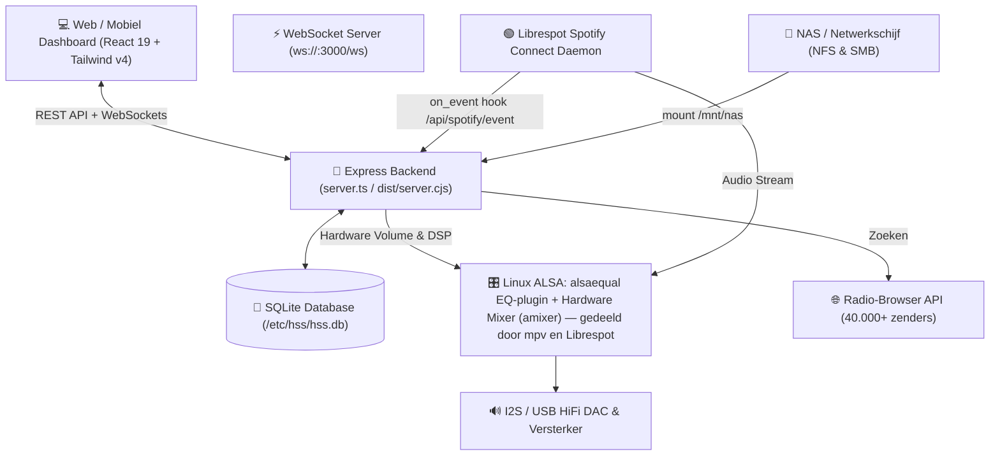

# 🎵 HSS HiddenSoundSystem

<div align="center">
  <h3>Audiophile Bit-Perfect Network Streamer & Multi-Source Media Hub</h3>
  <p><strong>Spotify Connect • 40.000+ Web Radio Zenders • NFS & SMB Netwerkschijven • ALSA I2S Hardware Mixer • SQLite Persistentie</strong></p>
</div>

---

## 📖 Overzicht

**HSS HiddenSoundSystem** transformeert een Raspberry Pi (gecombineerd met een I2S DAC zoals HiFiBerry, IQaudIO, Allo Boss of high-end USB DAC) in een professionele, bit-perfecte audiostreamer en media center in de stijl van Volumio en WiiM.

Het systeem biedt een moderne webinterface, sub-50ms WebSocket synchronisatie, realtime ALSA hardware volumeregeling en naadloos schakelen tussen diverse audiobronnen.

---

## ✨ Belangrijkste Functionaliteiten

### 1. 🟢 Spotify Connect & Live Metadata Engine
- **Bit-Perfect Streaming**: Werkt met native `librespot` daemon op de Pi.
- **Real-Time Event Hook**: `librespot` pusht track metadata direct naar `/api/spotify/event`.
- **High-Res Album Artwork Engine**: Parallelle oEmbed CDN resolver haalt officiële, haarscherpe albumhoezen op per track.
- **Spotify Playlists Importer**: Importeer elke openbare of persoonlijke Spotify afspeellijst direct via URL of ID.
- **Live Catalogus Zoekmachine**: Zoek live in de wereldwijde Spotify muziekcatalogus.

### 2. 📻 Internet Web Radio (40.000+ Zenders)
- **Radio-Browser API Integratie**: Doorzoek live meer dan 40.000 internationale internet radiozenders op naam, genre, land of stad.
- **Audiophile Direct Streams**: Ondersteunt hoge kwaliteit streams (tot 320 kbps MP3 / AAC / FLAC).
- **Live "Nu Speelt"-Metadata**: Waar de zender zelf een ICY `StreamTitle`-tag meestuurt, toont HSS het echte nummer (titel/artiest) in plaats van alleen de zendernaam — automatisch, geen configuratie nodig.
- **Permanente Zenderlijst**: Bewaar je favoriete zenders met één klik in de SQLite database.
- **Aangepaste Streams Toevoegen**: Handmatig toevoegen van aangepaste stream-URL's (.mp3, .aac, .m3u, .m3u8).

### 3. 📁 Lokale Muziek & Netwerkschijven (NAS / NFS / SMB)
- **NFS Protocol (Network File System)**: Native Linux kernel NFS v3/v4 ondersteuning voor minimale latency en maximale doorvoersnelheid (ideaal voor Synology/QNAP/Linux).
- **SMB / CIFS Protocol**: Eenvoudig koppelen van Windows shares en met wachtwoord beveiligde NAS-mappen.
- **Interactieve Bestanden Verkenner**: Blader met breadcrumb-navigatie door mappen op de Pi of het netwerk (`/mnt/nas`, `/media`, etc.) — Volumio-stijl, met "speel deze map af" naast per-nummer afspelen.
- **Hi-Res Audio Afspelen**: Direct afspelen van `.flac` (24-bit 96/192kHz), `.wav`, `.dsd`, `.dsf`, `.alac`, `.m4a` en `.mp3` via `mpv`, rechtstreeks naar de actieve ALSA DAC-uitgang (net als web radio — alleen Spotify Connect heeft z'n eigen `librespot`-daemon).
- **Echte Metadata**: Titel, artiest, album en duur komen uit de ingebedde tags van elk bestand (niet uit de bestandsnaam), met een optionele read-only koppeling met [Catalogic](https://catalogic.doorkoppen.nl) voor canonieke albumhoezen.
- **Afspeellijsten Genereren**: Maak met één klik een permanente afspeellijst van een complete map.
- **Koppelen zit bij Instellingen**: het protocol/host/pad/credentials-formulier staat onder Instellingen →
  Netwerkschijf (NAS/SMB); bladeren en afspelen blijft bij Bronnen en via de "Bron kiezen"-knop.

### 4. 🔄 Naadloos Live Wisselen van Bronnen (*Last Action Wins*)
- Schakel direct tussen Spotify Connect, Web Radio en NAS/Lokale audio zonder handmatig te pauzeren.
- **"Bron kiezen"**: één knop op zowel het Afspeelscherm als het Cast-scherm (ook bruikbaar rechtstreeks op
  de Nest Hub zelf) opent een snelkeuze-paneel met je opgeslagen radiozenders, de NAS-bestandsverkenner, en
  Spotify-status — zonder eerst naar Bronnen te hoeven navigeren.
- **Casten via de API**: `POST /api/cast/start` (optioneel met `deviceName`) start het cast-scherm op je
  Nest Hub, met een lege body vallend terug op je opgeslagen standaardapparaat — bruikbaar als Home
  Assistant `rest_command` voor "muziek via de Hub aanzetten" (zie `docs/API.md`, sectie 6).
- Zodra een nieuwe bron start, neemt deze automatisch en direct de ALSA audio-uitgang en het webdashboard over.

### 5. 🎛️ ALSA Hardware Mixer, Platformbrede EQ & DSP Audio Profiles
- **Directe Hardware Volumeregeling**: Stuurt de fysieke ALSA DAC hardware mixer aan (`Digital`, `Master`, `PCM`, `Analogue`) via `amixer` — automatisch de juiste kaart, ook op een Pi met meerdere geluidskaarten (bijv. de dubbele HDMI-uitgang van een Pi 5).
- **10-Band Equalizer, geldt voor élke bron**: draait op `libasound2-plugin-equal`, geplaatst in de gedeelde ALSA `default`-route — dus ook hoorbaar bij Spotify Connect, niet alleen bij NAS/webradio (die laatste twee spelen via `mpv`, dat geen DSP-ingang heeft op Spotify's eigen `librespot`-proces).
- **Stereo Balans, ook platformbreed**: een dB-proportionele verzwakking op het stille kanaal (niet een simpele volumeschaling — dat bleek op echte hardware verre van lineair), toegepast op dezelfde manier voor elke bron.
- **DAC Filters & Oversampling**: Configuratie voor Sabre ESS, Burr-Brown en AKM DAC chips (Linear Phase, Minimum Phase, NOS, Slow Roll-Off).
- **DSP Profielen**: Direct schakelen tussen audio profielen (Direct Bit-Perfect, Warm Analogue Vinyl, Tube Harmonics, Dynamic Headroom +3dB).

### 6. 💾 Permanente SQLite Database Opslag
- Alle data wordt direct opgeslagen in `/etc/hss/hss.db`:
  - Geïmporteerde afspeellijsten & tracks
  - Web radio zenders
  - Gekoppelde netwerkschijven (NFS & SMB)
  - Hardware instellingen & DAC configuraties
  - Artwork cache (0ms latency bij het afspelen van bekende nummers)

### 7. 🎨 Herontworpen Webinterface & Cast Designer
- **Design systeem**: rustige "premium consumer audio" stijl (flat surfaces, zachte ambient schaduwen) met 4 wisselbare kleurthema's (Obsidian Indigo, Nordic Slate, Spotify Emerald, Vintage Tube), volledig via CSS custom properties.
- **Bron-bewuste bediening**: transportknoppen zijn altijd beschikbaar bij NAS/lokale bestanden en webradio; bij Spotify alleen wanneer er echt een actieve Spotify Connect-sessie is — anders verdwijnen ze i.p.v. dode knoppen te tonen.
- **Cast Designer "Eigen ontwerp"**: volledig aanpasbare weergave voor de Google Nest Hub, opgebouwd uit vijf onafhankelijke onderdelen — albumhoes (plat/vinyl/cd/auto, elk met eigen grootte/vulling/middengaatje), titel & artiest (eigen lettergrootte per veld), klok (klein/groot, eigen lettergrootte/kleur/schaduw), frequentiespectrum (breedte/hoogte/doorzichtigheid) en bedieningsknoppen (grootte, plus wachtrij/bronkeuze) — plus een los instelbare volumebalk (breedte). Elk onderdeel heeft zijn eigen 9-punts ankerpunt (welke rand/hoek van het scherm) met een verschuiving en volgorde (z-index) daarbovenop, dus volledig los van elkaar te plaatsen. Achtergrond kan effen/gloed/verloop/albumhoes-blur/eigen afbeelding zijn. De editor toont de echte cast-pagina als live voorbeeld (geen aparte mockup) en wijzigingen verschijnen direct op een actief gecast scherm via WebSocket, zonder herladen.
- **Optionele standby-weergave**: toont een eigen klokscherm (met volledig onafhankelijke achtergrond/lettertype/accentkleur — los van de normale weergave) zodra er een instelbare tijd lang niets speelt, in plaats van de Nest Hub gewoon vrij te geven — kan ook uitgezet worden zodat pauzeren de Hub weer teruggeeft aan Google's eigen scherm. Verlaten kan met een knop in de Cast-tab of (waar een echte tik wél doorkomt — het lokale kiosk-scherm, of de cast-URL in een gewone browser) door op het standby-scherm zelf te tikken.

### 8. 🖥️ Systeembeheer (tabblad "Systeem")
- **Update-detectie**: controleert elk uur (en direct bij opstarten) of `origin/main` verder staat dan de lokale commit, met een melding in de sidebar en een "Nu updaten"-knop — geen automatische achtergrond-updates, alleen op verzoek.
- **Herstarten / Uitschakelen**: direct vanuit de webinterface, met een bevestigingsstap.
- **Back-up downloaden**: een consistente, online snapshot van `/etc/hss/hss.db` (via SQLite's eigen `backup()`-API, niet een ruwe bestandskopie — dat zou bij WAL-mode een corrupt bestand kunnen opleveren) rechtstreeks naar je eigen computer, geen opslag op de server.
- **Netwerkinstellingen**: interfaces (WiFi/Ethernet) met status/IP, WiFi-netwerken scannen en wisselen — rechtstreeks via `nmcli` (NetworkManager, de standaard op recente Raspberry Pi OS-releases).

---

## 🏗️ Systeemarchitectuur



---

## 🚀 Installatie & Uitrollen op de Raspberry Pi

### Vereisten op Raspberry Pi OS (64-bit Bookworm aanbevolen):
```bash
# Systeempakketten installeren
sudo apt-get update
sudo apt-get install -y nodejs npm alsa-utils libasound2-plugin-equal nfs-common cifs-utils git curl jq mpv gpiod
```
`libasound2-plugin-equal` (alsaequal) is wat de 10-band equalizer en de
stereo-balans platformbreed maakt — zie stap 3b hieronder. Zonder dit pakket
werken EQ/balans niet.

### 1. Repository Klonen & Builden:
```bash
cd /home/eelko
git clone git@github.com:ekoppen/HSS-HiddenSoundSystem.git
cd HSS-HiddenSoundSystem
npm install
npm run build
```

### 2. Mapstructuur Aanmaken:
```bash
sudo mkdir -p /mnt/nas
```
(`/etc/hss` — de map met de SQLite-database en configuratie — wordt door de
app zelf aangemaakt bij eerste start, als root.)

### 3. Systemd Service Activeren:
Maak het servicebestand aan: `/etc/systemd/system/hss.service`
```ini
[Unit]
Description=HSS HiddenSoundSystem Web & Audio Engine
After=network-online.target sound.target avahi-daemon.service
Wants=network-online.target sound.target

[Service]
Type=simple
User=root
WorkingDirectory=/home/eelko/HSS-HiddenSoundSystem
ExecStart=/usr/bin/npm start
Restart=always
RestartSec=5
Environment=NODE_ENV=production
Environment=PORT=3000
LimitRTPRIO=95
LimitMEMLOCK=infinity

[Install]
WantedBy=multi-user.target
```
De service draait bewust als **root** — nodig voor directe ALSA hardware-toegang,
het wegschrijven van systemd-units (lokaal kiosk-scherm, GPIO), en `apt-get`
provisioning vanuit de webinterface zelf.

**Beheerdersaccount** — geen enkel wachtwoord staat in de broncode (dat was
vroeger wel zo, met een hardcoded fallback-wachtwoord publiek in de git-
geschiedenis van deze repo). `setup.sh` vraagt hier interactief naar; volg je
dit handmatige pad, maak dan zelf `/etc/hss/admin-seed.json` aan vóórdat je de
service voor het eerst start — hij wordt bij die eerste boot gelezen en
meteen daarna verwijderd:
```bash
sudo mkdir -p /etc/hss
sudo tee /etc/hss/admin-seed.json > /dev/null << 'EOF'
{"email": "jij@voorbeeld.nl", "name": "Jouw Naam", "password": "kies-hier-iets-sterks"}
EOF
sudo chmod 600 /etc/hss/admin-seed.json
```
Sla je dit over, dan genereert de app zelf een willekeurig wachtwoord bij de
eerste boot en toont dat één keer in de systemd-log (`sudo journalctl -u
hss.service | grep -i wachtwoord`). Wachtwoord kwijt? `sudo npx tsx
scripts/reset-password.ts <email> <nieuw-wachtwoord>` — herschrijft de hash
direct in de database en herstart de service zodat het meteen actief is.

Herlaad en start de service:
```bash
sudo systemctl daemon-reload
sudo systemctl enable --now hss.service
sudo systemctl status hss.service
```

### 3b. `/etc/asound.conf` — Bit-Perfect Routing + Platformbrede EQ/Balans:
`default` (het ALSA-apparaat dat zowel `mpv` als `librespot --device default`
gebruiken) routeert hier bewust door de `equal`-plugin heen vóór het de
hardware bereikt — dat is wat EQ en stereo-balans voor **elke** bron laat
gelden (Spotify Connect incluis), niet alleen NAS/webradio. Zoek eerst je
kaartindex op (`cat /proc/asound/cards`) — een Pi zonder onboard HDMI-audio
die al is uitgeschakeld is meestal kaart `0`, maar met bijv. de dubbele HDMI
van een Pi 5 ervoor kan je DAC op een hoger nummer staan:
```bash
sudo tee /etc/asound.conf > /dev/null << 'EOF'
pcm.!default {
    type plug
    slave.pcm "eq"
}

ctl.!default {
    type hw
    card 0
}

pcm.hifisoloist {
    type hw
    card 0
    device 0
}

pcm.eqbase {
    type equal
    slave.pcm "hifisoloist"
}

ctl.eqbase {
    type equal
}

pcm.eq {
    type plug
    slave.pcm "eqbase"
}
EOF
```
Vervang beide `card 0`-regels door je eigen kaartindex als die anders is.
Test daarna of de 10 EQ-band-controls verschijnen: `amixer -D eqbase controls`.

### 4. Librespot (Spotify Connect) Installeren & Configureren:
Installeer `librespot` via het `raspotify`-pakket (up-to-date, onderhouden build)
en schakel zijn eigen standaard-service uit — je draait zo dadelijk je eigen,
op HSS afgestemde service in plaats daarvan:
```bash
sudo apt-get install -y raspotify
sudo systemctl disable --now raspotify
```

Maak de event-hook aan die librespot's afspeel-events doorstuurt naar HSS:
```bash
sudo mkdir -p /opt/hss
sudo tee /opt/hss/spotify-event.sh > /dev/null << 'EOF'
#!/usr/bin/env bash
# Real-Time Spotify Event Hook for Librespot / HSS HiddenSoundSystem

if command -v jq >/dev/null 2>&1; then
  PAYLOAD=$(jq -n \
    --arg event "${PLAYER_EVENT:-none}" \
    --arg track_id "${TRACK_ID:-}" \
    --arg track_name "${NAME:-}" \
    --arg artist_name "${ARTISTS:-}" \
    --arg album_name "${ALBUM:-}" \
    --arg duration_ms_raw "${DURATION_MS:-}" \
    --arg position_ms_raw "${POSITION_MS:-}" \
    --argjson volume "${VOLUME:-65535}" \
    --arg uri "${URI:-}" \
    '{
      event: $event,
      track_id: $track_id,
      track_name: $track_name,
      artist_name: $artist_name,
      album_name: $album_name,
      duration_ms: (if $duration_ms_raw == "" then null else ($duration_ms_raw | tonumber) end),
      position_ms: (if $position_ms_raw == "" then null else ($position_ms_raw | tonumber) end),
      volume: ($volume // 65535),
      uri: $uri
    }')
else
  PAYLOAD=$(python3 -c "
import os, json
data = {
  'event': os.environ.get('PLAYER_EVENT', 'none'),
  'track_id': os.environ.get('TRACK_ID', ''),
  'track_name': os.environ.get('NAME', ''),
  'artist_name': os.environ.get('ARTISTS', ''),
  'album_name': os.environ.get('ALBUM', ''),
  'duration_ms': int(os.environ['DURATION_MS']) if os.environ.get('DURATION_MS') else None,
  'position_ms': int(os.environ['POSITION_MS']) if os.environ.get('POSITION_MS') else None,
  'volume': int(os.environ.get('VOLUME', 65535) or 65535),
  'uri': os.environ.get('URI', '')
}
print(json.dumps(data))
")
fi

curl -s -X POST "http://localhost:3000/api/spotify/event" \
  -H "Content-Type: application/json" \
  -d "$PAYLOAD" >/dev/null 2>&1 || true
EOF
sudo chmod +x /opt/hss/spotify-event.sh
```

Maak de credential-cache-map aan (`sudo mkdir -p /etc/hss/librespot-cache`)
en maak `/etc/systemd/system/librespot-hss.service` aan — pas alleen
`--name` aan naar de apparaatnaam die je ook in Instellingen → Spotify HSS
daemon gebruikt. **Laat `--device` op `default` staan** — dat is bewust géén
specifieke kaartnaam: `default` is precies het ALSA-apparaat dat stap 3b
hierboven door de EQ-plugin routeert, dus alleen zo passen EQ en balans ook
toe op Spotify Connect. Een specifieke `hw:CARD=...`/`sysdefault:CARD=...`
zou die routing juist omzeilen:
```ini
[Unit]
Description=Librespot Spotify Connect Daemon for HiFi DAC
After=network.target sound.target hss.service

[Service]
Type=simple
User=root
ExecStart=/usr/bin/librespot --name "HSSwoonkamer" --backend alsa --device default --bitrate 320 --enable-volume-normalisation --volume-ctrl linear --initial-volume 75 --zeroconf-port 5354 --system-cache /etc/hss/librespot-cache --onevent /opt/hss/spotify-event.sh
Restart=always
RestartSec=5
LimitRTPRIO=95
LimitMEMLOCK=infinity

[Install]
WantedBy=multi-user.target
```

```bash
sudo systemctl daemon-reload
sudo systemctl enable --now librespot-hss.service
sudo systemctl status librespot-hss.service
```

---

## 🛠️ REST API & WebSocket Documentatie

Zie [`docs/API.md`](docs/API.md) voor de volledige endpoint documentatie inclusief request en response schema's voor:
- `GET/POST /api/playback/*`
- `GET/POST /api/hardware/*`
- `GET/POST /api/spotify/*`
- `GET/POST/DELETE /api/radio/*`
- `GET/POST /api/nas/*`
- `WebSocket (ws://<ip>:3000/ws)`

Ga je hierin ontwikkelen? Zie [`ARCHITECTURE.md`](ARCHITECTURE.md) voor hoe
`state.ts`, de routebestanden, de WebSocket-events en de frontend
samenhangen — inclusief de bekende valkuilen.

---

## 📦 Ontwikkeling & Scripts

| Commando | Omschrijving |
| :--- | :--- |
| `npm run dev` | Start de ontwikkelserver met hot-reloading (`tsx server.ts`) |
| `npm run build` | Bouwt Vite frontend en bundelt Node backend (`dist/server.cjs`) |
| `npm start` | Start de gebundelde productieserver (`node dist/server.cjs`) |
| `npm run lint` | Voert TypeScript type checks uit |

---

## 📄 Licentie
GPL-3.0 — vrij te gebruiken en aan te passen; afgeleide werken moeten onder dezelfde licentie open blijven. Zie [LICENSE](LICENSE).
